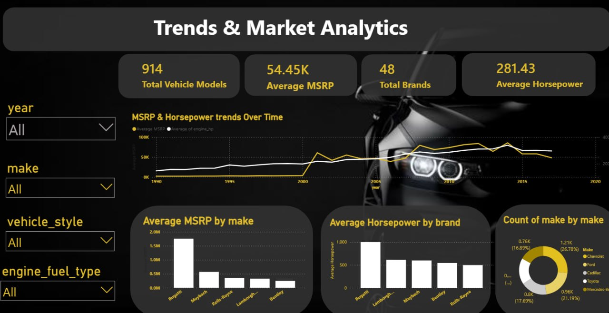
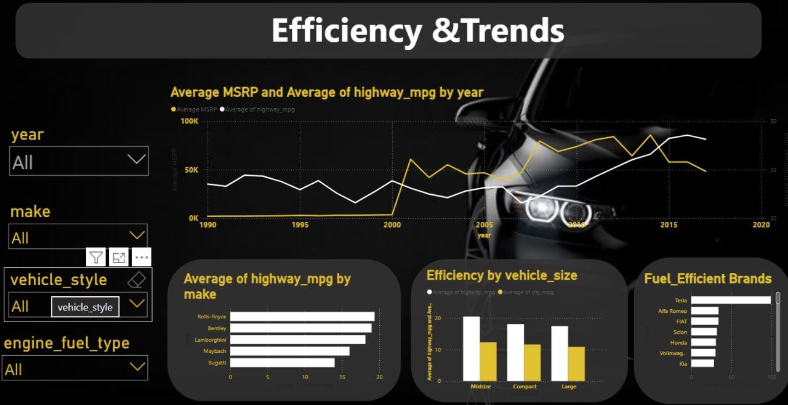
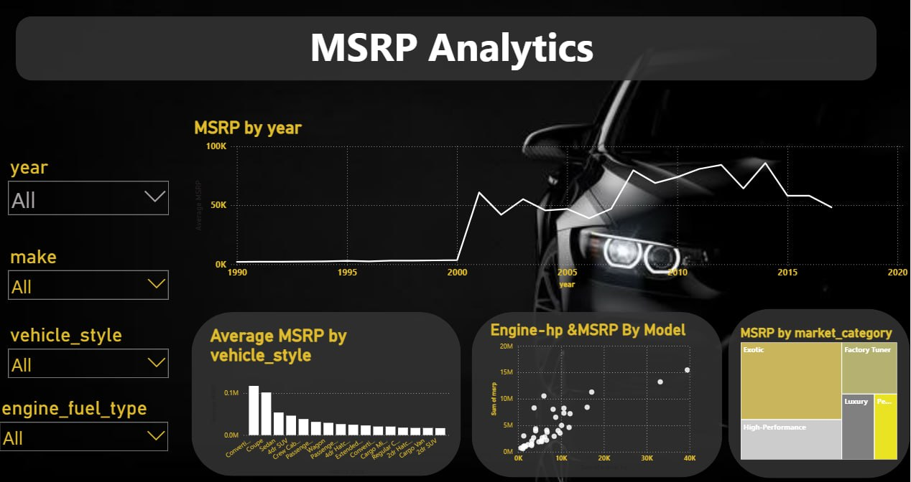

# Car Data Analysis & Interactive Power BI Dashboard

Analysis of 11,900+ vehicles: cleaned raw data with Python (Pandas) and built a 3-page interactive Power BI dashboard.

## The Challenge
Raw dataset with duplicates, missing values, and inconsistent formatting.

## What I Did
- Removed 715 duplicate records
- Handled missing values across 5 columns
- Engineered a new feature: Car Age
- Built a 3-page interactive Power BI dashboard

## Key Insights
- Luxury and performance strongly drive price; Bugatti and Maybach lead with average prices above $1.5M
- Clear inverse relationship between luxury/performance and fuel efficiency
- Steady upward trend in price and horsepower over time, especially post-2000
- Chevrolet and Ford together account for nearly 48% of all vehicle models

## Dashboard Preview

## Files
- `data.csv`: raw dataset
- `data_cleaned.csv`: dataset after cleaning
- `dash2.pbit`: Power BI dashboard template

## Tools
Python · Pandas · Power BI

## Author
Wafaa Hamada Sobhi
